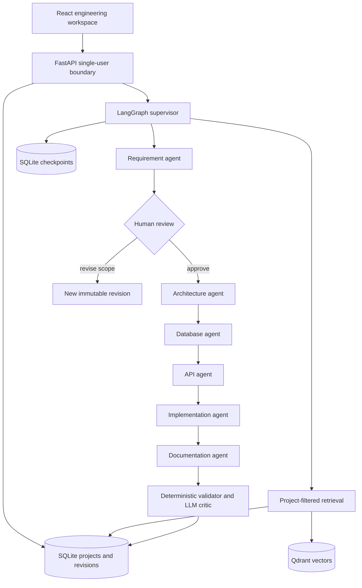

# Final-year project guide

## Suggested title
**A Traceable Multi-Agent System for Software Engineering Blueprint Generation**

## Problem statement
Single-response AI planning often produces plausible artifacts without explicit
links between requirements, storage, APIs and implementation work. Omissions can
remain invisible until development. This system makes those links inspectable
and applies validation that is independent of model confidence.

## Contributions to demonstrate
1. Typed contracts and specialized agent prompts with bounded retries.
2. Supervisor context passing and a human approval boundary.
3. Durable state and explicit recovery from a failed stage or server restart.
4. A traceability matrix with independent reference and consistency checks.
5. Project-scoped vector retrieval with recorded source passages.
6. Versioned design revisions, structured comparison and exportable artifacts.
7. A measurement plan with reproducible offline fault injection tests.

Using several prompts alone is not a research contribution. Explain the
contracts, state transitions, provenance, evaluation results and failure modes.
The reviewer is an LLM and can make mistakes too; deterministic checks supply a
separate layer of evidence. No metric here claims to prove a design correct.

## System architecture

## Viva demonstration (8–10 minutes)
- Explain the user problem and show a project's brief and constraints.
- Create a revision; inspect functional requirements and measurable NFRs.
- Explain the human decision boundary, approve, then inspect artifact IDs.
- Walk an order-tracking requirement through component, entity, endpoint and task.
- Explain the difference between declared coverage and semantic correctness.
- Show a validator fault-injection test removing the cancellation endpoint.
- Show persisted execution events, prompt version, tokens and failure recovery.
- Add a business policy, retrieve it, then start a new revision to show source IDs.
- Export the draft OpenAPI document and explain request/response schemas.
- Show revision comparison and explain remaining limitations.

Use live Gemini for the final project demonstration once configured and tested.
Offline demo fixtures are appropriate for UI rehearsal and repeatable tests;
they are not evidence of AI generation quality.

## Evaluation protocol (to run with a live key)
Use five held-out briefs: delivery, library, clinic appointment, inventory,
and campus resource booking. Specify 6–10 expected domain behaviors per case
before generation. Run three trials per configuration:

| Configuration | Purpose |
|---|---|
| Single prompt, same artifact schemas | Baseline |
| Staged agents, no project knowledge | Context decomposition ablation |
| Staged agents with retrieved project rules | Retrieval contribution |
| Staged agents + deterministic checks + critic | End-to-end design review |

Record model name, prompt version, date, source corpus and per-run token/time
metrics. Human reviewers rate completeness, correctness and consistency against
the predefined behaviors. Record validator precision/recall for injected missing
links, unknown IDs, duplicate operations and cyclic tasks. Rate semantic issues
separately: linked IDs can still describe the wrong behavior.

Do not fill the results chapter with invented numbers. The repository's offline
tests establish functional invariants only. Model quality, retrieval relevance,
cost and latency require live measurements. Keep source material free of real
personal records; use synthetic clinic and student examples.

## Suggested report chapters
Introduction; related work; requirements; architecture; methodology; implementation;
evaluation; limitations; conclusion and future work. Include class/schema
diagrams, state transitions, API contracts and real screenshots in appendices.

## Known boundaries and extensions
- No automatic design repair: findings lead to human refinement in a new revision.
- No generated code execution or autonomous deployments.
- No task scheduler, distributed queue, OAuth or multi-user tenancy.
- Context is bounded by schema guidance and provider output limits; very large
  projects should be split into smaller scopes. No claim of unlimited context.
- Vector retrieval selects a small set of passages, not guaranteed exhaustive
  knowledge. Model changes require reindexing existing documents.
- NFRs include verification proposals, not measured guarantees.
- Advanced future work: role-based teams, PostgreSQL checkpointing, parallel
  workers, automatic requirement change-impact propagation, stronger semantic
  evaluation and bounded repair with human approval.
